<!-- Panels are generated by scripts/build.py. Edit the content there, then run: python3 scripts/build.py -->




<a href="https://github.com/Malinga14/sendra"></a>
<a href="https://github.com/Malinga14/NEXTJS-SSG-TEMPLATE"></a>
<a href="https://github.com/Malinga14/board-app"></a>
<a href="https://github.com/Malinga14/Level-Up-AL-Backend"></a>


<a href="https://malingapasindu.com"></a><a href="mailto:hello@malingapasindu.com"></a><a href="https://linkedin.com/in/malinga-pasindu"></a><a href="https://x.com/malinga14"></a><a href="https://instagram.com/__malii__14"></a>

